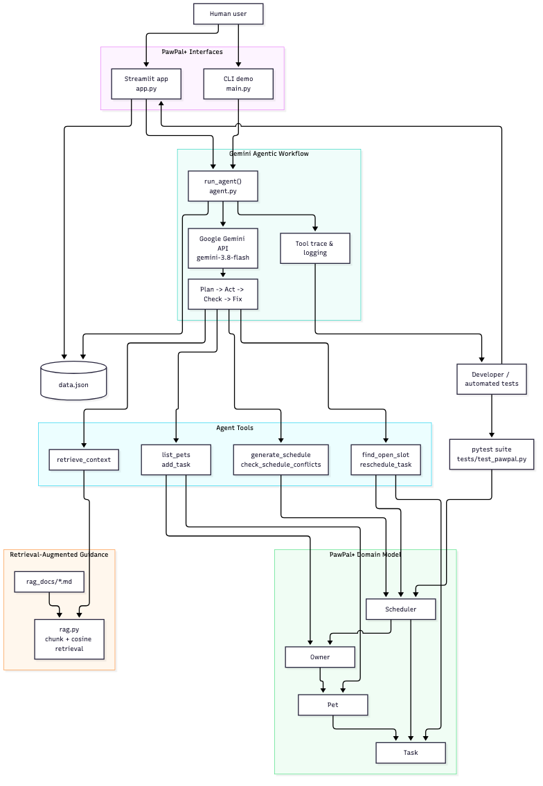

# PawPal+ — Module 2 Project Evolved with Agentic AI

This project originated as my Module 1–3 PawPal+ submission: a rule-based pet-care scheduler for tracking pets and scheduling, sorting, completing, and persisting their care tasks. PawPal+ helps an owner organize walks, feeding, grooming, medication, vet visits, and play by applying priority, time, conflict, recurrence, and availability constraints.

The final system extends that original application with a Gemini-powered agentic workflow. The agent can interpret plain-language requests, use PawPal+'s real scheduling tools, check its own output, and attempt to resolve conflicts.

## Scenario

A busy pet owner needs help staying consistent with pet care. They want an assistant that can:

- Track pet care tasks (walks, feeding, meds, enrichment, grooming, etc.)
- Consider constraints (time available, priority, owner preferences)
- Produce a daily plan and explain why it chose that plan

Your job is to design the system first (UML), then implement the logic in Python, then connect it to the Streamlit UI.

## What you will build

Your final app should:

- Let a user enter basic owner + pet info
- Let a user add/edit tasks (duration + priority at minimum)
- Generate a daily schedule/plan based on constraints and priorities
- Display the plan clearly (and ideally explain the reasoning)
- Include tests for the most important scheduling behaviors

## ✨ Features

- **Priority-based daily scheduling** — `Scheduler.generate_schedule()` fills the day by priority (high → low), then earliest-scheduled-first, stopping once the day's time constraints are met.
- **Sorting by time** — `Scheduler.sort_by_time()` re-orders any task list chronologically by `scheduled_time`, pushing unscheduled tasks to the end.
- **Sorting by priority, then time** — `Scheduler.sort_by_priority()` orders tasks high → low priority, then by `scheduled_time` (earliest first, unscheduled last), then shortest → longest duration as a final tiebreaker.
- **Task filtering** — `Owner.filter_tasks()` narrows the full task list by completion status and/or pet name.
- **Conflict warnings** — `Scheduler.check_conflict()` (single task) and `Scheduler.find_conflicts()` (full audit) detect true overlapping time *ranges*, not just identical start times, within a pet or across pets; `explain_conflicts()` renders them as readable warnings.
- **Daily/weekly recurrence** — `Task.mark_complete()` and `Scheduler.complete_task()` automatically generate the next occurrence of a recurring task when it's marked done.
- **Next-available-slot finder** — `Scheduler.find_next_available_slot()` scans a task list and returns the earliest open gap (of a requested length, optionally after a given time) that doesn't overlap anything already scheduled.
- **Recurrence conflict auto-resolve** — `Scheduler.resolve_recurrence_conflict()` builds on the slot finder: if a freshly-recurring task would land on top of something else, it's automatically bumped to the next open slot instead of silently overlapping.
- **JSON persistence** — `Owner.save_to_json()` / `Owner.load_from_json()` (backed by `to_dict()`/`from_dict()` on `Task`, `Pet`, and `Owner`) let the whole system — every pet and every task — survive between runs.
- **Formatted output** — emoji priority/task-type labels and a `tabulate`-rendered CLI table (`formatting.py`, used by `main.py`), plus color-coded priority badges in the Streamlit UI.
- **📚 Retrieval-Augmented Pet-Care Guidance (RAG)** — `rag.py` loads local Markdown from `rag_docs/`, splits it into paragraph chunks, retrieves the most relevant guidance with term-frequency cosine similarity, and exposes it to Gemini through a `retrieve_context` tool. Retrieved text is shown in the agent trace and used to ground general responses, not replace veterinary advice.
- **🤖 AI Scheduling Assistant (Agentic Workflow)** — `agent.py`'s `run_agent()` turns a plain-language request ("Mochi needs a walk and a vet visit after lunch, both high priority") into real changes: it plans by calling `add_task`, acts by calling `generate_schedule`, checks its own work with `check_schedule_conflicts`, and fixes anything it finds with `find_open_slot` + `reschedule_task` — repeating the check/fix step until the schedule is clean. Wired into both `app.py` (an "AI Scheduling Assistant" section with a text box, a step-by-step trace, and the resulting schedule) and `main.py` (a CLI demo at the end of the run). See **AI Scheduling Assistant** below for setup and how it maps to the assignment's AI-feature requirement.

## 🤖 AI Scheduling Assistant (Agentic Workflow)

This is the project's required "advanced AI feature": an **agentic workflow** built on the Google Gemini API (`google-genai` Python SDK, model `gemini-3.8-flash`, using function-calling tools in `agent.py`). It's fully integrated into the main application — the agent calls the same `Scheduler` methods the rest of the app uses (`generate_schedule`, `find_conflicts`, `find_next_available_slot`, `reschedule`), it doesn't just print retrieved data alongside a canned answer.

**Why this counts as an agentic workflow, specifically:** the agent runs a real plan → act → check → fix loop, matching the assignment's own example ("a coding assistant that writes, tests, and then fixes code automatically"):

1. **Plan** — turns the request into one or more `add_task` calls (grounded against the owner's real pets via `list_pets`, so it never invents a pet).
2. **Act** — calls `generate_schedule` to build the day's plan.
3. **Check** — calls `check_schedule_conflicts` to verify its own work.
4. **Fix** — if conflicts are found, calls `find_open_slot` + `reschedule_task` to resolve them, then checks again.

**RAG retrieval:** Before answering requests that involve feeding, walks, grooming, medication, vet visits, or conflicts, the agent can call `retrieve_context`. PawPal+ searches local documents in `rag_docs/`, ranks paragraph chunks by cosine similarity, and returns the cited source text to Gemini. This improves grounding without sending the pet-care library to a third-party vector service.

**Guardrails & logging:** every tool call is wrapped in its own try/except (a bad pet name, task field, or time string comes back as a clear error string instead of crashing the run) and logged via the standard `logging` module and an in-memory trace shown in the UI; the loop is capped (`max_iterations`, default 8) so a confused run can't go forever.

### Setup

```bash
pip install -r requirements.txt   # installs the Google Gemini SDK too
export GOOGLE_API_KEY="your-key-here"   # get one at https://aistudio.google.com/apikey
```

Without a key set, both `main.py` and the Streamlit app still run normally — the AI section just reports that it's skipped (CLI) or shows a friendly error (UI) instead of crashing.

### Sample interactions

The following examples show the intended input and output behavior. Availability and live wording may vary because Gemini is a hosted model.

**Example 1 — add and check tasks**

- Input: `Mochi needs a 30 minute walk and a vet visit sometime after lunch, both high priority.`
- Typical result: the agent calls `list_pets`, calls `add_task` twice, calls `generate_schedule`, calls `check_schedule_conflicts`, and summarizes the resulting plan.
- UI: the trace expander shows every tool call and output, followed by the resulting schedule table.

**Example 2 — resolve a conflict**

- Input: `Schedule a 20 minute grooming session for Luna at 9:00.`
- If that time overlaps an existing task, the agent calls `find_open_slot`, calls `reschedule_task`, and checks conflicts again.
- Result: a plain-language summary reports the moved task and its new time.

**Example 3 — missing pet**

- Input: `Add a 10 minute feeding task for Pixel.`
- Result: `list_pets` establishes that Pixel is not in the owner's pet list, so the agent does not invent a pet and asks or tells the user to add Pixel first.

## System Architecture

The architecture diagram shows the Streamlit and CLI interfaces, Gemini agentic workflow, plan/act/check/fix tools, PawPal+ domain model, JSON persistence, and human/test review points.



Editable Mermaid source: [diagrams/architecture.mmd](diagrams/architecture.mmd)

## Design Decisions

- **Kept scheduling logic in `pawpal_system.py`.** The Gemini agent calls existing domain methods instead of replacing them or implementing scheduling through prompt-only reasoning. This keeps the system deterministic and testable.
- **Used a bounded plan–act–check–fix loop.** Gemini may add tasks, generate a schedule, inspect conflicts, find an open slot, and reschedule tasks, but it is limited to eight iterations to avoid runaway cost or loops.
- **Grounded tools in real application state.** Tool closures receive the current `Owner`, `Scheduler`, and request trace, so task names and operations act on the user's saved data rather than fabricated examples.
- **Separated the AI integration.** `agent.py` owns Gemini and tool orchestration; `app.py` and `main.py` only present results and handle persistence or friendly error states.
- **Chose explicit guardrails.** Tool calls catch malformed input, unknown pets/tasks, and invalid times. API credential, quota, server, and network failures are converted into concise user-facing messages.
- **Preserved the deterministic app.** Manual pet/task entry and schedule generation remain available even when Gemini is unavailable or has no API key.

## Implementation Summary

The system is four classes in `pawpal_system.py`. `Task` represents a single piece of care work — a description, duration, priority, and scheduled time. `Pet` holds a pet's identity and health info and owns its own list of `Task`s. `Owner` holds a list of `Pet`s and can flatten every pet's tasks into one list with `get_all_tasks()`. `Scheduler` is the only class with ordering logic: it reads tasks exclusively through `Owner.get_all_tasks()` (never from a single `Pet` directly, so scheduling always spans every pet an owner has), ranks them by priority and duration, and assigns each one a time slot within the day's constraints — the result can be rendered as a readable timeline with `explain_plan()`. `Task`, `Pet`, and `Owner` also know how to turn themselves into plain dicts (`to_dict()`/`from_dict()`), which is what makes `Owner.save_to_json()`/`load_from_json()` possible. A separate `formatting.py` module keeps emoji/color presentation logic out of the domain model entirely. `main.py` demonstrates the whole flow end to end: build an `Owner` with two `Pet`s, add tasks to each, print the generated schedule, and exercise every stretch feature (slot-finding, recurrence conflict resolution, persistence).

## Getting started

### Setup

```bash
python -m venv .venv
source .venv/bin/activate  # Windows: .venv\Scripts\activate
pip install -r requirements.txt
export GOOGLE_API_KEY="your-key-here"  # needed for the AI Scheduling Assistant — see below
```

### Suggested workflow

1. Read the scenario carefully and identify requirements and edge cases.
2. Draft a UML diagram (classes, attributes, methods, relationships).
3. Convert UML into Python class stubs (no logic yet).
4. Implement scheduling logic in small increments.
5. Add tests to verify key behaviors.
6. Connect your logic to the Streamlit UI in `app.py`.
7. Refine UML so it matches what you actually built.

## 🖥️ Sample Output

```
Today's Schedule
=================
07:00 — Vet checkup (20 min, high priority)
07:20 — Morning walk (30 min, high priority)
07:50 — Feeding (10 min, high priority)
08:00 — Litter box cleaning (15 min, medium priority)
08:15 — Evening walk (20 min, medium priority)
```

## 🧪 Testing PawPal+ and the Agent

The full suite currently contains 19 tests. Existing domain tests verify completion, sorting, conflicts, recurrence, slot finding, and persistence. The added agent helper tests verify pet/task lookup and 24-hour time parsing without making any Gemini API calls.

Without a Gemini key, the CLI and Streamlit app both degrade to a friendly skip/error state. Live Gemini verification requires a valid key and available model quota.


Tests live in `tests/test_pawpal.py` and cover the core domain logic end to end:

- **Task completion** — marking a task complete flips `is_completed`.
- **Pet task tracking** — adding a task to a `Pet` increases its task count.
- **Sorting correctness** — `Scheduler.sort_by_time()` returns tasks in chronological order, with unscheduled tasks pushed to the end.
- **Priority sorting with tiebreak** — `Scheduler.sort_by_priority()` orders by priority first, then by `scheduled_time`, even when a lower-priority task is scheduled earlier.
- **Recurrence logic** — completing a `recurrence="daily"` task returns a new `Task` for the next day (via `Task.mark_complete()`).
- **Conflict detection** — `Scheduler.find_conflicts()` flags two tasks on the same pet scheduled at the same time.
- **Next-available-slot finder** — `Scheduler.find_next_available_slot()` returns the correct gap between two scheduled tasks, and `None` when the day is already full.
- **Recurrence conflict auto-resolve** — `Scheduler.resolve_recurrence_conflict()` moves a task off of a real overlap and confirms the move actually resolved the conflict.
- **Persistence round-trip** — `Owner.save_to_json()` followed by `Owner.load_from_json()` reproduces the same owner, pet, and task data (including dates and times).

```bash
# Run the full test suite:
python -m pytest

# Run with coverage:
python -m pytest --cov
```

Sample test output:

```
============================= test session starts ==============================
platform darwin -- Python 3.14.7, pytest-9.1.1, pluggy-1.7.0
rootdir: /Users/cottonskaka/Desktop/Codepath/ai110-module2show-pawpal-starter1
configfile: pytest.ini
plugins: anyio-4.15.1
collected 19 items

tests/test_pawpal.py ...................                              [100%]

============================== 19 passed in 0.40s ==============================
```

### Confidence Level

⭐⭐⭐⭐☆ (4/5) — All 19 tests pass, covering task completion, pet task tracking, chronological and priority+time sorting, daily recurrence, conflict detection, slot-finding, recurrence conflict auto-resolve, JSON persistence, and agent helper parsing. Confidence isn't a full 5 stars because live model availability and provider-side quota/latency remain outside the unit test environment.

## 🔎 Reflection

The detailed limitation, misuse-prevention, testing-surprise, and human-AI collaboration discussion is in [model_card.md](model_card.md).

Building this feature reinforced that an AI agent should orchestrate dependable application tools rather than replace domain logic. Keeping `Scheduler` responsible for scheduling and conflict detection made the agent reviewable and kept AI mistakes from silently corrupting the core model. The most useful collaboration behavior was separating generated code from verified behavior: reviewing each tool signature, tracing real callers, checking diagnostics, and rerunning the 16-test suite.

One limitation is that hosted-model behavior can vary or be temporarily unavailable, so the app retains a deterministic manual workflow and a friendly fallback. A useful next step would be adding a mock Gemini test layer and a small evaluation set for pet grounding, conflict resolution, and malformed input handling.

## ✅ Reliability and Evaluation

The AI feature is evaluated at two levels: deterministic automated tests for its helper logic and live, human review of Gemini requests through the Streamlit UI.

### Automated checks

| Test input or condition | Evaluation criterion | Result |
|---|---|---|
| `_find_pet(owner, "Mochi")` | Finds an existing pet case-insensitively | Pass |
| `_find_pet(owner, "Unknown")` | Returns a clear available-pet error instead of crashing | Pass |
| `_find_task(owner, "Mochi", "Morning walk")` | Finds an existing task under the specified pet | Pass |
| `_find_task(owner, "Mochi", "Unknown")` | Returns a clear available-task error | Pass |
| `_parse_time("14:30")` | Parses a valid 24-hour time | Pass |
| `_parse_time("not-a-time")` | Rejects malformed input with a corrective `HH:MM` message | Pass |
| `PetCareKnowledgeBase.retrieve("feeding duration")` | Retrieves the matching local feeding guidance | Pass |
| Empty RAG query | Returns no fabricated context | Pass |

The full suite also covers scheduling correctness, conflict detection, recurrence, slot finding, persistence, and task behavior. At last run, **19 tests passed** locally without any Gemini API call.

### Runtime guardrails and logging

- Each agent tool catches malformed input and returns an explanation that Gemini can use for the next step.
- Unknown pets and tasks are never silently invented or deleted.
- The agent loop is capped at eight iterations.
- Missing keys and Gemini authentication, quota, server, and connection failures are converted into concise UI/CLI messages.
- Every tool call is recorded in the in-memory trace with tool name, input, output, and a standard `logging` entry.

### Human evaluation

Live Gemini evaluation should be recorded by a human after a successful provider response. The following template is deliberately not marked as passed until it has been run.

| Test input | Evaluation criterion | Result |
|---|---|---|
| `Mochi needs a 30 minute walk and a vet visit sometime after lunch, both high priority.` | Uses real pet names, adds appropriate tasks, generates a schedule, and checks conflicts | Pending live verification |
| `Add a 10 minute feeding task for Pixel.` | Reports that Pixel is unknown instead of inventing a pet | Pending live verification |
| Request containing a malformed or impossible time | Handles the error gracefully and asks for/uses a valid `HH:MM` time | Pending live verification |

## 📐 Smarter Scheduling

| Feature | Method(s) | Notes |
|---------|-----------|-------|
| Task sorting | `Scheduler.sort_by_priority()`, `Scheduler.sort_by_time()` | `sort_by_priority()` orders tasks high → low priority, then shortest → longest duration, and is what `generate_schedule()` uses to build the day's plan. `sort_by_time()` orders tasks by `scheduled_time` ascending, pushing any unscheduled (`None`) tasks to the end — useful for re-sorting a schedule after manual reschedules. |
| Filtering | `Owner.filter_tasks(is_completed=None, pet_name=None)` | Returns tasks matching either or both of: completion status, and/or a specific pet's name. Both filters are optional and combine with AND logic, so you can ask for e.g. "Mochi's incomplete tasks" in one call. |
| Conflict handling | `Scheduler.check_conflict()`, `Scheduler.find_conflicts()`, `Scheduler.explain_conflicts()` | Conflicts are true overlapping time *ranges* (start + duration), not just identical start times, so two tasks that merely abut don't falsely flag. `check_conflict(task, other_tasks)` is a lightweight, single-task check — it scans once, stops at the first overlap, and returns a warning string (or `None`) instead of raising, so it's safe to call right after any `reschedule()`. `find_conflicts(tasks)` is the full audit — it sorts once by start time and returns every overlapping pair across all pets, same-pet or cross-pet, skipping completed tasks to avoid false positives from a finished recurring task's own next-occurrence clone. `explain_conflicts(owner, conflicts)` renders those pairs as readable lines naming each task's pet. |
| Recurring tasks | `Task.mark_complete()`, `Scheduler.complete_task()` | When a task with `recurrence="daily"` or `"weekly"` is completed, `Task.mark_complete()` marks it done and returns a new `Task` for the next occurrence (fresh id, `due_date` advanced by 1 day or 7 days). Since a `Task` has no reference back to its `Pet`, `Scheduler.complete_task(owner, task_id)` is the entry point that finds the task across the owner's pets, calls `mark_complete()`, and appends the returned next-occurrence task back onto that same pet's task list. |
| Next-available-slot finder | `Scheduler.find_next_available_slot(tasks, duration_minutes, day_start, day_end, after)` | Walks the already-scheduled, incomplete tasks in time order and checks each gap (before the first task, between two tasks, after the last one) against the requested duration. `after` lets a caller say "find me a slot after 2pm" without pre-filtering the task list. Returns `None` if nothing in `[day_start, day_end]` is big enough. |
| Recurrence conflict auto-resolve | `Scheduler.resolve_recurrence_conflict(owner, task, day_start, day_end)` | Composes `check_conflict()` + `find_next_available_slot()`: if a task (typically a freshly-created recurring next-occurrence) overlaps something else the owner has scheduled, it's moved to the next open slot at or after its current time. Returns whether a move happened, so a caller can tell the user their recurring task shifted. |

## 💾 Data Persistence

**Workflow:** on startup, `app.py` checks whether `data.json` exists next to it. If it does, the owner (every pet, every task) is loaded straight from it via `Owner.load_from_json()`; if not, a fresh `Owner` is created. From then on, every mutating action — adding a pet, adding a task, generating a schedule — calls a small `persist()` helper that writes the current owner back out with `Owner.save_to_json()`. The net effect: closing the browser tab and reopening the app (or restarting `streamlit run`) brings everything back exactly as it was.

**Serialization approach:** `Task`, `Pet`, and `Owner` each implement `to_dict()`/`from_dict()` by hand rather than pulling in a library like `marshmallow`. The only field types that aren't natively JSON-serializable are `datetime.time` and `datetime.date` (on `Task.scheduled_time` and `Task.due_date`), so `to_dict()` converts those to ISO-format strings and `from_dict()` parses them back with `time.fromisoformat()` / `date.fromisoformat()`. Everything else (strings, ints, floats, bools, nested dicts/lists) round-trips through `json.dump`/`json.load` unchanged. A hand-written conversion was simpler than adding a schema library for a system with only three classes to serialize.

**Files modified:** `pawpal_system.py` (added `to_dict()`/`from_dict()` to `Task`, `Pet`, `Owner`, plus `Owner.save_to_json()`/`load_from_json()`), `app.py` (load-on-startup + `persist()` calls after each mutation), `main.py` (demonstrates a save/load round trip), `.gitignore` (excludes the generated `data.json` from version control), `tests/test_pawpal.py` (round-trip test).

## 🎨 Professional UI & Output Formatting

Presentation logic (emojis, colors, table rows) lives in its own `formatting.py` module rather than inside `pawpal_system.py` — the domain classes stay UI-agnostic, and only `main.py`/`app.py` import `formatting`.

- **Priority labels** — `formatting.priority_label()` renders `🔴 High` / `🟡 Medium` / `🟢 Low`; `formatting.priority_color()` gives a matching hex color for UI elements that support it.
- **Task-type icons** — `formatting.task_type_icon()` maps each task type to an emoji (🚶 walk, 🍖 feeding, 🎾 outdoor_activity, ✂️ grooming, 💊 medication, 🩺 vet, 🧸 play), with a generic 📋 fallback for anything else.
- **Status labels** — `formatting.status_label()` renders `✅ Done` / `⏳ Pending`.
- **CLI tables** — `main.py` uses the [`tabulate`](https://pypi.org/project/tabulate/) library to render the whole day's schedule as an aligned table, with `formatting.task_to_row()` building each row.
- **Streamlit UI** — `app.py`'s task tables (the full task list, the generated schedule) use the same `formatting.task_to_row()` helper, so the web UI and the CLI show identical emoji/priority formatting.

## 📸 Demo Walkthrough

### UI features (`app.py`)

- Enter the owner's name and add one or more pets (species, breed, age, weight, height), shown in a pet table.
- Add care tasks to a selected pet (description, task type, duration, priority).
- View every task across all pets at once, toggle sorting (Priority vs. Scheduled time), and filter by pet and/or completion status.
- See an inline conflict warning as soon as two visible tasks' time ranges overlap.
- Click "Generate schedule" to build the day's plan, with task-count / total-minutes metrics and a conflict-free confirmation (or warning) for the generated plan.
- Search for the next open time slot of a given length with "Find Next Available Slot," without manually scanning the task list.
- Data persists automatically: adding a pet/task or generating a schedule saves to `data.json`, which is reloaded the next time the app starts.

### Example workflow

1. Enter the owner's name (e.g., "Jordan") and add a pet, e.g., Mochi the Shiba Inu.
2. Add tasks for Mochi: "Morning walk" (30 min, high priority) and "Feeding" (10 min, high priority).
3. Open "All tasks" and sort by Priority — both tasks show in priority order with no conflicts detected.
4. Click "Generate schedule" to see today's plan, starting at 7:00 AM, with Mochi's high-priority tasks scheduled first.

### Key Scheduler behaviors shown

- **Sorting** — switching "Sort by" between Priority and Scheduled time re-orders the same task list via `sort_by_priority()` / `sort_by_time()`. Priority sorting now breaks ties by scheduled time (Challenge 3), not duration.
- **Conflict warnings** — scheduling two tasks whose time ranges overlap (same pet or different pets) immediately surfaces a warning via `find_conflicts()` / `explain_conflicts()`.
- **Daily recurrence** — completing a task with `recurrence="daily"` creates its next occurrence automatically via `complete_task()`.
- **Next-available-slot finder** — `find_next_available_slot()` locates the first open gap of a requested length, demonstrated below finding 09:00 open after the morning tasks.
- **Recurrence conflict auto-resolve** — when a recurring task's next occurrence lands on an already-booked time, `resolve_recurrence_conflict()` bumps it to the next open slot automatically.
- **Persistence** — `save_to_json()` / `load_from_json()` round-trip the entire owner (pets, tasks, completion status, due dates) through `data.json`.

### Sample CLI output (`python main.py`)

This output demonstrates the enhanced priority → time scheduling logic (Challenge 3): among the three `high`-priority tasks, the one with the earliest original `scheduled_time` (Vet checkup, 06:45) is placed first, ahead of Morning walk (07:30) and Feeding (08:15) — priority still wins over everything, but time now breaks the tie instead of duration.

```
Today's Schedule
=================
07:00 — Vet checkup (20 min, high priority)
07:20 — Morning walk (30 min, high priority)
07:50 — Feeding (10 min, high priority)
08:00 — Litter box cleaning (15 min, medium priority)
08:15 — Evening walk (20 min, medium priority)

Recurring Task Rollover
========================
Completed 'Litter box cleaning' -> created next occurrence (due 2026-10-21, task_id=aacc83a3)

All Tasks Sorted by Time
=========================
07:00 — Vet checkup (20 min, high priority)
07:20 — Morning walk (30 min, high priority)
07:50 — Feeding (10 min, high priority)
08:00 — Litter box cleaning (15 min, medium priority)
08:00 — Litter box cleaning (15 min, medium priority)
08:15 — Evening walk (20 min, medium priority)

Incomplete Tasks Only
======================
07:50 — Feeding (10 min, high priority)
07:20 — Morning walk (30 min, high priority)
08:15 — Evening walk (20 min, medium priority)
07:00 — Vet checkup (20 min, high priority)
08:00 — Litter box cleaning (15 min, medium priority)

Completed Tasks Only
======================
08:00 — Litter box cleaning (15 min, medium priority)

Mochi's Tasks Only
====================
07:50 — Feeding (10 min, high priority)
07:20 — Morning walk (30 min, high priority)
08:15 — Evening walk (20 min, medium priority)

Lightweight Conflict Check (single task)
===========================================
Warning: 'Evening walk' at 07:15 conflicts with 'Morning walk' at 07:20.

Full Conflict Audit (entire schedule)
========================================
07:00-07:15 overlap: 'Vet checkup' (Luna) vs 'Evening walk' (Mochi)
07:15-07:20 overlap: 'Evening walk' (Mochi) vs 'Morning walk' (Mochi)

Same-Time Conflict Check
==========================
Warning: 'Nail trim' at 10:00 conflicts with 'Playtime' at 10:00.

Formatted Schedule (emojis + table)
======================================
time    pet    task                    duration    priority    status
------  -----  ----------------------  ----------  ----------  ---------
07:00   Luna   🩺 Vet checkup           20 min      🔴 High      ⏳ Pending
07:15   Mochi  🚶 Evening walk          20 min      🟡 Medium    ⏳ Pending
07:20   Mochi  🚶 Morning walk          30 min      🔴 High      ⏳ Pending
07:50   Mochi  🍖 Feeding               10 min      🔴 High      ⏳ Pending
08:00   Luna   ✂️ Litter box cleaning  15 min      🟡 Medium    ✅ Done
08:00   Luna   ✂️ Litter box cleaning  15 min      🟡 Medium    ⏳ Pending
10:00   Mochi  ✂️ Nail trim            15 min      🟢 Low       ⏳ Pending
10:00   Luna   🧸 Playtime              15 min      🟢 Low       ⏳ Pending

Find Next Available Slot
===========================
Next open 15-minute slot after 09:00: 09:00

Recurrence Conflict Auto-Resolve
===================================
Next occurrence inherited the same time: 11:00
Warning: 'Evening medication' at 11:00 conflicts with 'Grooming session' at 11:00.
Auto-resolved: moved to 11:30 to avoid the conflict.

Persistence (save/load)
==========================
Saved current owner, pets, and tasks to data.json
Reloaded owner 'Jordan' with 2 pet(s) and 11 task(s) from data.json
```
